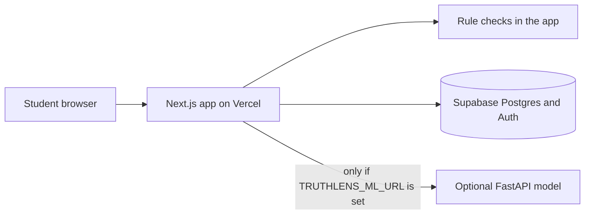

# TruthLens AI

[](LICENSE)

TruthLens AI helps secondary-school students and other young internet users pause before they trust a message, a link, or an educational offer. It explains the warning signs it finds. It does not tell anyone that something is completely safe.

This is an original project for HIASFEST 2027, Category K: ICT and Technology. The theme is cybersecurity for safer digital spaces.

## Problem

Young people receive scholarship offers, job messages, login warnings, and pressure in the same chats they use for school. A scary score, or a promise that a link is safe, does not teach them what to look for. Many “opportunity” lists also hide whether a deadline is real, expired, or simply made up.

## Who it is for

- Secondary-school students
- Teenagers using chat, email, and social apps
- Students comparing scholarships, grants, competitions, and internships
- Teachers or judges walking through a live demonstration

## What it does

- Checks pasted messages for scam language, phishing requests, fake opportunities, payment or identity asks, urgency, harassment, and manipulation.
- Checks an `http` or `https` address for explainable structural warning signs, without opening the site.
- Lists educational opportunities with provider, deadline, source, and verification labels. The built-in records are fictional demonstration data.
- Offers eight short Academy lessons with questions and feedback.
- Lets a signed-in user save and delete private reports, and save opportunities.
- Lets a guest try the checks, lessons, and demonstration opportunities without an account.

A separate Gemma 4 reading is optional. Set `GEMINI_API_KEY` on the server and the check sends the submitted text to Google's Gemini API. The rule checks still run and are not replaced by that reading. The older Python service stays unused until a model file is trained.

## What is not claimed

- No accuracy percentage is published, because a held-out evaluation has not been run on a licensed dataset in this repository.
- Demonstration opportunities are not real scholarships.
- A quiet result is not a safety certificate.
- Suspicious wording is not a court finding or a confirmed fraud.
- Insults and threats are language patterns. They do not prove what the sender intended.
- Writing style is not used to declare a claim false.

## Screenshots

Do not add invented pictures. Capture these from a running app and save them under `docs/screenshots/` if you want them in a slide:

1. Landing page, desktop width.
2. Message check with a suspicious example and the indicator list visible.
3. Link check showing a lookalike domain.
4. Opportunities page with the demonstration banner.
5. One Academy lesson after the questions are marked.
6. The same message check on a phone-width window.

## Features

| Area | Status |
| --- | --- |
| Landing page, Academy, and guest checks | Implemented |
| Explainable message and link checks | Implemented in the Next.js server |
| Accounts, private reports, bookmarks | Implemented when Supabase is configured |
| Row Level Security migration | Written and covered by a policy test. Not executed against a hosted database in this build |
| Opportunity admin insert | Implemented for emails listed in `ADMIN_EMAILS`, using the service role |
| Gemma 4 reading | Implemented when `GEMINI_API_KEY` is set. Shown separately from the rule checks |
| Python model service | Implemented. Used only when Gemma is not configured. Returns “unavailable” until you train a model |
| Live threat-intelligence lookup | Not implemented. No third-party URL is fetched |
| Automated scraping of scholarships | Not implemented |

## Architecture



The browser never receives the service-role key. Message and link checks do not open the submitted URL. Reports are stored only after sign-in, and the original text is stored only when the user opts in.

## Technology

- Next.js App Router, React, TypeScript, Tailwind CSS, Lucide
- Route handlers for the application API
- Supabase Auth and Postgres with Row Level Security
- Optional FastAPI service using scikit-learn, pandas, and joblib
- Vitest for the web checks, pytest for the model helpers

Third-party packages keep their own licences. The MIT licence on this repository does not relicense datasets or those packages.

## Local setup

Requirements: Node.js 24, npm, and Python 3.13 if you want the model service.

```bash
npm install
copy .env.example .env.local
npm run dev
```

Open `http://localhost:3000`. Guest checks work with the environment file left blank.

### Environment variables

| Name | Where | Purpose |
| --- | --- | --- |
| `NEXT_PUBLIC_SUPABASE_URL` | Browser and server | Supabase project URL |
| `NEXT_PUBLIC_SUPABASE_ANON_KEY` | Browser and server | Supabase anon key. RLS still applies |
| `SUPABASE_SERVICE_ROLE_KEY` | Server only | Admin inserts of opportunities. Bypasses RLS |
| `ADMIN_EMAILS` | Server only | Comma-separated emails allowed to add opportunities |
| `TRUTHLENS_ML_URL` | Server only | Optional Python model service. Checked text is sent there when Gemma is not configured |
| `GEMINI_API_KEY` | Server only | Google AI Studio key. Checked text is sent to the Gemini API for a Gemma 4 reading |
| `GOOGLE_GEMMA_MODEL` | Server only | `gemma-4-26b-a4b-it` (default) or `gemma-4-31b-it` |
| `NEXT_PUBLIC_SITE_URL` | Browser | Public site URL, used in docs and redirects |

Never prefix the service-role key with `NEXT_PUBLIC_`.

### Supabase

1. Create a project at [supabase.com](https://supabase.com).
2. Put the project URL and anon key in `.env.local`.
3. In the SQL editor, run `supabase/migrations/20261024120000_init.sql`, then `supabase/seed.sql`.
4. In Authentication, decide whether new users must confirm email. The sign-up screen explains that step.
5. Add `http://localhost:3000/auth/callback` to the redirect allow list. Add the Vercel URL as well when you deploy.
6. For **Continue with Gmail**, open Authentication → Providers → Google and turn it on. In Google Cloud, create an OAuth client and set the authorised redirect to `https://<project-ref>.supabase.co/auth/v1/callback`. Paste that client id and secret into Supabase, not into this repository. Gmail sign-in does not use `GEMINI_API_KEY`.
7. For the Gemma 4 reading, create an API key in Google AI Studio and put it in `GEMINI_API_KEY`. That key stays on the server. Do not prefix it with `NEXT_PUBLIC_`.

The migration enables RLS. Private tables compare `(select auth.uid())` with the owner column. Opportunities and lesson titles are publicly readable. There is no client insert policy on opportunities. A sample row cannot be marked `official_checked`.

This build did not run those statements against a live database. After you apply them, sign in as two users and confirm that one cannot open the other’s report.

### Model service

```bash
cd ml
python -m venv .venv
.venv\Scripts\activate
pip install -r requirements.txt
uvicorn api.main:app --reload --port 8000
```

From the project root, set `TRUTHLENS_ML_URL=http://127.0.0.1:8000` and restart `npm run dev`.

Training:

```bash
cd ml
python -m truthlens_ml.train
```

Run that from `ml` with `src` on `PYTHONPATH`, or:

```bash
cd ml
$env:PYTHONPATH = "src"
python -m truthlens_ml.train
```

The command stops if `ml/data/raw/messages.csv` is missing. It does not invent a score. Read `ml/data/MANIFEST.md` before adding a file. PhishTrap and the federated phishing-URL set are URL datasets, so they are not valid training data for the message checker. The Sting9 message set was not downloaded; confirm its licence on the dataset page before use.

Evaluation writes `ml/models/evaluation.json` with precision, recall, F1, the confusion counts, and a few mismatched examples. Those files are gitignored. False negatives can hide a real scam. False positives can frighten a student who pasted an ordinary message. Report both, and do not describe a test-set number as real-world accuracy.

### API

| Method | Path | Behaviour |
| --- | --- | --- |
| `GET` | `/api/health` | App status. Says whether Supabase and the model URL are configured |
| `POST` | `/api/analyze/message` | `{ "text", "category" }` up to 4000 characters |
| `POST` | `/api/analyze/url` | `{ "url" }` up to 2048 characters. `http` and `https` only |
| `GET` `POST` `DELETE` | `/api/reports` | Private reports for the signed-in user |
| `GET` `DELETE` | `/api/reports/:id` | One report owned by that user |
| `GET` `POST` `DELETE` | `/api/bookmarks` | Saved opportunities for the signed-in user |
| `POST` | `/api/quiz` | Stores a lesson score for the signed-in user |
| `POST` | `/api/admin/opportunities` | Admin insert. Requires an allow-listed email and the service role |
| `GET` | `/auth/callback` | Completes a Supabase email link. Redirect targets must be relative |
| `POST` | `/auth/signout` | Signs out |

Model service, when running: `GET /health`, `POST /analyze-message`, `POST /analyze-url`.

Errors are short sentences. Stack traces are not returned.

## Scripts

```bash
npm run dev
npm run lint
npm run typecheck
npm test
npm run build
npm run test:ml
```

## Deployment

The GitHub repository is `devinuwa/truthlens-ai`. Import that repository in Vercel. Set the environment variables in the Vercel project settings, not in a committed file. The build command is `npm run build`.

The Python service is separate. A free host that can run FastAPI is enough. Put its public URL in `TRUTHLENS_ML_URL`. Leave that variable empty if you only want the rule checks. Do not send user messages to a model host you have not reviewed.

This document does not claim a live Vercel URL. Confirm the deployment in the Vercel dashboard after import.

## Security and privacy

Read `docs/THREAT_MODEL.md` and `SECURITY.md`. In short: guests can check without an account, reports are private, the original message is optional, the service-role key stays on the server, and pasted links are not fetched.

Serious threats, payment loss, or ongoing harassment should go to a trusted adult, a teacher, or a local authority. The app is not an emergency service, and it does not shame someone for being targeted.

## Limitations

- The rules miss wording that is not in the list, and they can flag a harmless sentence that happens to match.
- Link checks do not see the page, the certificate owner, or a redirect destination.
- No external reputation service is connected.
- Model metrics are not available until you train on a licensed file.
- Supabase RLS is specified and tested as SQL text. It still needs a two-user check on your project.

## Contributing

See `CONTRIBUTING.md`. Please keep results explainable and avoid absolute safety claims.

## Licence

MIT. Copyright (c) 2026 devinuwa. See [LICENSE](LICENSE).
