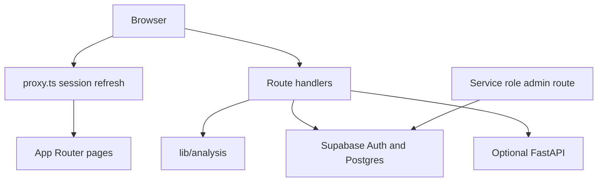

# Architecture

The browser talks only to the Next.js application. Route handlers validate JSON with Zod, apply a small in-memory rate limit, and call pure TypeScript checkers.

## Data

- `profiles` — display name for the signed-in user
- `analysis_reports` — private results
- `opportunities` — public catalogue, written by the service role
- `saved_opportunities` — private bookmarks
- `lessons` — public titles mirrored from the Academy
- `quiz_attempts` — private scores

Lesson body text lives in `lib/academy/lessons.ts` so the Academy works without the database.

## Why the rules live in TypeScript

Judges can run the checks on a laptop with Node only. The Python process is an add-on for training and for a later probability score. The two results are shown separately so a model cannot overwrite an explanation.

## Deployment shape

- Vercel runs the Next.js app.
- Supabase hosts Auth and Postgres.
- A second host can run `uvicorn api.main:app` if a model file is present.

Local development does not need the second host.
